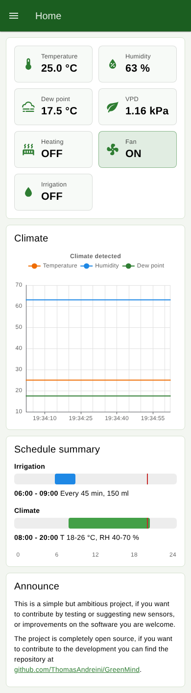
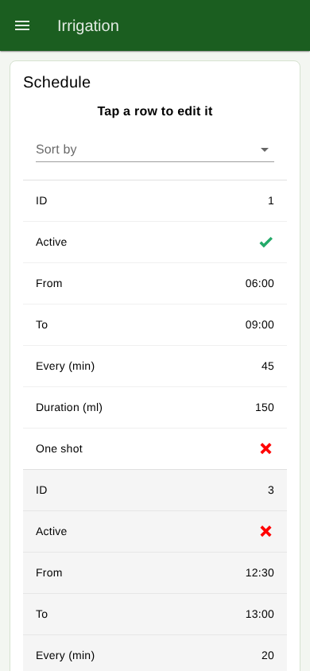
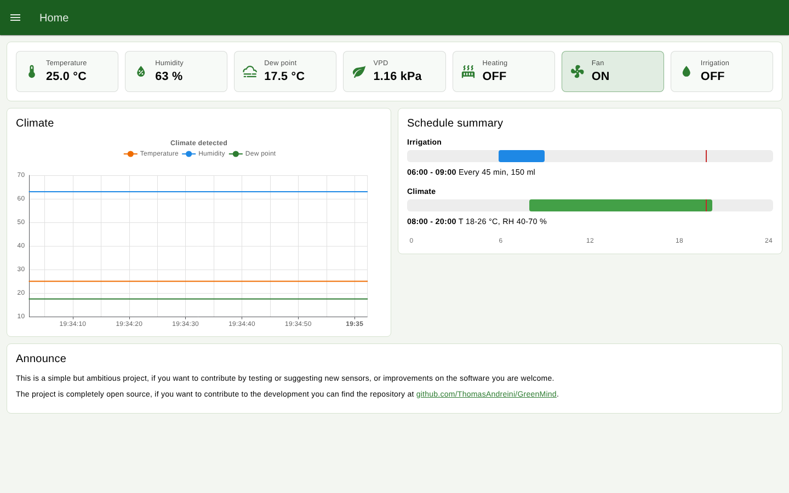

GreenMind
==============

### About

GreenMind is a software designed for the management of a indoor crop. The intent is to allow complete control of a small greenhouse or an indoor crop that can be managed from a web interface accessible from both PC and smartphone.
Through GreenMind it is possible to manage irrigation, climate, artificial lighting, heating and ventilation of the environment. Each operation performed and data detected is recorded and shown as a graph and table.
GreenMind  is a ready-to-use product but it was created with the intention of being as open as possible, it is therefore developed through Node Red, a visual language that is very simple to learn and modify if the user wants to adapt it to specifics. needs.
The platform is the popular Raspberry pi, a low-cost board with great potential.
GreenMind runs on a Raspberry Pi with the 64 bit Raspberry Pi OS (Pi 3, 4, 5 or Zero 2 W), some hardware components such as relays and temperature and humidity sensors are required.
Support for other hardware components will be implemented over time, the goal is to use hardware components that are easy to find, at an affordable cost and of good quality. The user can choose which software modules and which hardware components to use according to their needs and budget.

<p align="center">
  
  
</p>
<p align="center">
  
</p>

### What's new in 1.0

- **Responsive dashboard** built with [Dashboard 2.0](https://dashboard.flowfuse.com): one column on
  smartphones, two on tablets and desktops, three on wide screens. Tables become a stacked list on
  narrow screens, tap a row to edit it. It can be installed on the home screen as an app (PWA).
- **Home status tiles**: temperature, humidity, dew point, VPD, heating, fan and irrigation at a glance,
  with alarms for sensor offline and VPD out of range.
- **Psychrometer**: relative humidity, dew point and VPD (vapour pressure deficit) are computed from
  dry bulb and wet bulb temperatures, corrected for the altitude of the greenhouse.
- **Failsafe**: if the sensors do not answer for 5 minutes, heating and fan driven by the schedule are
  switched off and the event is logged.
- **Climate history** saved in the database for 30 days.
- **Security**: editor and dashboard are protected by user name and password.
- **64 bit and up to date runtime**: Node-RED 5 on Node.js 24 LTS on Raspberry Pi OS 64 bit, Raspberry Pi 5 supported,
  Node.js memory sized on the RAM of the board.
- **Backup and migration**: one command saves database, settings and password, the installer restores them.

### Requirements

- A Raspberry Pi able to run the **64 bit** Raspberry Pi OS (Bookworm or newer, Lite recommended)
- Relay board for irrigation pump, heating and fan
- A board that exposes the dry bulb and wet bulb temperatures over HTTP (see [Sensors](#sensors))

| Board                         | RAM                  | Node.js heap set by the installer | Notes                                   |
| ----------------------------- | -------------------- | --------------------------------- | --------------------------------------- |
| Raspberry Pi 5                | 2 / 4 / 8 / 16 GB    | 448 / 960 / 1024 / 1024 MB        | Recommended                             |
| Raspberry Pi 4, Pi 400        | 1 / 2 / 4 / 8 GB     | 256 / 448 / 960 / 1024 MB         | Recommended                             |
| Raspberry Pi 3 B, 3 B+        | 1 GB                 | 256 MB                            |                                         |
| Raspberry Pi 3 A+, Zero 2 W   | 512 MB               | 256 MB                            | Swap set to 1 GB, enough for GreenMind  |
| Raspberry Pi 1, 2, Zero, Zero W | -                  | -                                 | 32 bit only: not supported          |

GreenMind (Node-RED, dashboard and database) uses about 130-150 MB of RAM: 1 GB or more leaves room
for the operating system and for other services.

### Installation

1. Write **Raspberry Pi OS Lite (64-bit)** on the SD card with [Raspberry Pi Imager](https://www.raspberrypi.com/software/).
   In the OS customisation set host name, user, Wi-Fi and enable SSH.
2. Log in on the Raspberry Pi (for example `ssh <user>@<hostname>.local`) and check that the OS is 64 bit:
   `dpkg --print-architecture` must print `arm64`.
3. Run:

```bash
curl -fsSL -o greenmind_installer https://github.com/ThomasAndreini/GreenMind/releases/latest/download/greenmind_installer
bash greenmind_installer
```

The installer checks the OS and the memory, installs Node.js 24 and Node-RED, copies GreenMind in
`~/.node-red`, installs the required nodes, sizes the Node.js memory, asks for the user name and
password used to protect the editor and the dashboard, and starts Node-RED at boot.

Optional environment variables:

| Variable                     | Use                                                                    |
| ---------------------------- | ---------------------------------------------------------------------- |
| `GM_REF`                     | branch or tag to install (the release installer uses its own tag)      |
| `NODERED_VERSION`            | Node-RED version (default `5.0.8`)                                     |
| `NODE_MAJOR`                 | Node.js major version, `24` (default) or `22`                          |
| `GM_HEAP_MB`                 | Node.js heap in MB, instead of the size computed from the RAM          |
| `GM_RESTORE`                 | backup to restore, see [Migrating](#migrating-to-raspberry-pi-os-64-bit) |
| `GM_USER`, `GM_PASSWORD`     | editor and dashboard credentials, to install without prompts           |

When it finishes open:

- Dashboard: `http://<raspberry-ip>:1880/dashboard`
- Node-RED editor: `http://<raspberry-ip>:1880`

### Memory

The Node.js heap limit is a quarter of the RAM, from 256 MB to 1024 MB (see the table above). The
installer writes it in a systemd drop-in, so it is kept when Node-RED is updated:

```bash
cat /etc/systemd/system/nodered.service.d/greenmind.conf   # current value
free -h                                                    # RAM and swap in use
systemctl status nodered                                   # memory used by Node-RED
```

On boards with less than 1 GB of RAM the installer sets the swap file to 1 GB (`/etc/dphys-swapfile`).
To change the heap run the installer again with `GM_HEAP_MB=<MB>`.

### Migrating to Raspberry Pi OS 64 bit

GreenMind needs the 64 bit OS: on a 32 bit system the installer stops. To move an existing
installation (1.x or a previous 0.x version, on the same or on a new Raspberry Pi) without losing data:

1. **Back up** on the old system:

   ```bash
   curl -fsSL -o greenmind_backup https://github.com/ThomasAndreini/GreenMind/releases/latest/download/greenmind_backup
   bash greenmind_backup
   ```

   It stops Node-RED for a moment and creates `~/greenmind-backup-<date>.tar.gz` with the database
   (schedules, irrigation and climate history), the settings (flow rate, relay levels, sensor host,
   altitude) and, from 1.0, the password. Copy it to your PC, for example
   `scp <user>@<old-raspberry>:~/greenmind-backup-*.tar.gz .`
2. **Write Raspberry Pi OS Lite (64-bit)** on a new SD card (keep the old one as a fallback) and start
   the Raspberry Pi, as in [Installation](#installation).
3. **Copy the backup** to the new system (`scp greenmind-backup-*.tar.gz <user>@<hostname>.local:~`)
   and **install restoring it**:

   ```bash
   GM_RESTORE=~/greenmind-backup-<date>.tar.gz bash greenmind_installer
   ```

   The installer only extracts the known GreenMind files from the backup. The password is kept if
   the backup comes from 1.0 or newer, otherwise a new one is asked.

Changes for who comes from a previous version (0.x):

- The dashboard moved from `/ui` to `/dashboard` and needs the password.
- The flow is in `~/.node-red/greenmind/greenmind.json`, the database stays in `~/greenmind/main.db`.
- The legacy `node-red-dashboard`, `node-red-node-ui-table`, `node-red-contrib-ui-led` and
  `node-red-contrib-ui-timelines-chart` nodes are no longer used.

### Wiring

Outputs use BCM numbering, the relay logic level when inactive can be set on the Settings section of
each page.

| Output          | BCM GPIO | Physical pin |
| --------------- | -------- | ------------ |
| Irrigation pump | 22       | 15           |
| Heating         | 17       | 11           |
| Fan             | 27       | 13           |

### Sensors

Every 60 seconds GreenMind reads two HTTP endpoints from the sensor board (host configurable in
*Climate > Settings*, default `climahub.local`):

- `http://<host>/sensor/temperatura` dry bulb temperature
- `http://<host>/sensor/bulbo_umido` wet bulb temperature

Both must answer with a JSON containing the value in °C, for example `{"value": 21.4}`
(the format used by ESPHome's web server).

### Development

The `Test` flow is disabled by default: enable it in the editor to simulate temperature and humidity
during the day (`climate.testmode`).

Tests run on every push with GitHub Actions ([CI workflow](.github/workflows/ci.yml)):

```bash
npm ci
npm test                            # unit tests: the code of the function nodes run in a sandbox
npx playwright install chromium
npm run test:e2e                    # Node-RED + dashboard driven by a browser, with a fake sensor board
npm run lint:installer              # installer and backup scripts, requires shellcheck
```

Pushing a tag `vX.Y.Z` equal to the version in `package.json` runs the tests and publishes a GitHub
release with the flow and an installer pinned to that version.
